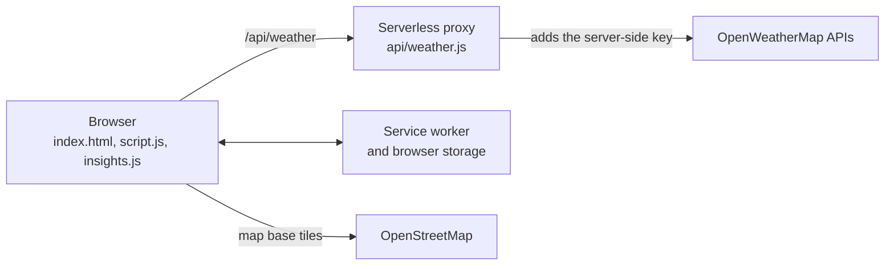

# SkyPulse — An Intelligent Weather Dashboard with Personalized Insights

SkyPulse turns raw forecast data into decisions: when to go out, what to wear and what to watch for. It ranks the best time windows for your activity, factoring in air quality, and explains every recommendation.

[](https://github.com/rkslakshay/weather-dashboard/actions/workflows/ci-deploy.yml)
[](manifest.json)

- **Live app:** https://weather-dashboard-five-pearl.vercel.app
- **Repository:** https://github.com/rkslakshay/weather-dashboard
- **Feature status:** [CHECKLIST.md](CHECKLIST.md)

---

## Problem

Weather apps report temperature, wind, rain chance and pollution as separate numbers, and leave you to work out what they mean together. A mild, dry evening can look perfect for a run while the air is unhealthy. Free forecasts also report only every 3 hours, and smooth hourly displays can hide which values are estimates.

SkyPulse combines these factors into ranked, explainable recommendations, and labels what is measured and what is estimated.

## Features

- **Weather Window Finder:** the best 3-hour periods for walking, running, cycling and outdoor dining, with scores and reasons.
- **Personal Weather Briefing:** guidance on clothing, rain, sun protection, air quality and wind, with the most important items first.
- **Scrollable 5-day timeline:** a custom SVG temperature curve. The hero, tiles, air quality and sky follow the selected moment, by scroll, drag, click or keyboard.
- **Forecast analytics:** a Chart.js chart of temperature, precipitation chance and optional wind.
- **Weather map:** Leaflet with rain, cloud, temperature and wind layers.
- **Environmental data:** US AQI and pollutants, UV, dew point, wind compass, visibility, pressure, and a sunrise-sunset arc.
- **Living sky:** sun, moon, stars, clouds, rain, snow, fog and lightning driven by the forecast and the sun's position.
- **Places:** autocomplete search, geolocation, favorites, recent places and city comparison.
- **PDF report:** conditions, briefing, top windows, forecast table and chart, in the selected units.
- **Installable PWA:** offline support, with saved data labelled by age.
- **Display options:** °C/°F across every value, plus light and dark themes.

## Technology Stack

| Area | Technology |
|---|---|
| Frontend | HTML5, CSS3, vanilla JavaScript (ES6+), SVG |
| Backend | Node.js serverless function on Vercel |
| Charts and maps | Chart.js 4.4.1 (bundled locally), Leaflet 1.9.4, OpenStreetMap tiles |
| PDF | html2pdf.js 0.10.1 |
| Browser APIs | Service Worker, Cache, Web Storage, Geolocation, Fetch |
| Data | OpenWeatherMap |
| Quality | Node.js test runner, GitHub Actions |
| Hosting | Vercel |

There is no build step, no framework and no npm dependency.

## Architecture



| File | Purpose |
|---|---|
| `index.html`, `style.css` | Page structure and design system |
| `script.js` | UI, API layer, timeline, map, chart and PDF |
| `insights.js` | Pure scoring and briefing engines, with no browser or network dependency |
| `api/weather.js` | Serverless proxy that holds the API key and allow-lists endpoints |
| `service-worker.js` | Offline shell and network-first data caching |
| `dev-server.js` | Zero-dependency local server, including the API route |
| `vendor/chart.umd.js` | Chart.js, bundled so the chart works offline |
| `test/` | Automated tests |

SkyPulse has no database and no accounts. Preferences, places and saved responses stay in the visitor's browser.

## Weather API Integration

All requests go through `/api/weather`, which adds the key on the server. The browser never receives it. The proxy:

- allows only known endpoints, and known map layers with numeric tile coordinates
- returns a 400 for missing query parameters and a clear 500 when the server key is missing
- ignores any `appid` a caller supplies

The app uses current weather, the 5-day/3-hour forecast, current and forecast air pollution, UV, geocoding and weather map tiles. Requests time out after 12 seconds, responses are cached by data type for 10 to 60 minutes, and a failed search keeps the current city on screen.

## Weather Window Finder and AQI-Aware Scoring

SkyPulse ranks non-overlapping 3-hour windows up to 48 hours ahead. Selecting one moves the timeline to it and highlights the period. Scoring is deterministic and uses no AI model:

1. **Metric scores.** Temperature, rain chance, wind, humidity and gusts each score 0–100 against the activity's preferences.
2. **Weighted average.** Each activity has its own weights.
3. **Deductions.** Rain, snow, storms, heat, sub-zero feels-like temperatures, cycling gusts, low visibility, smoke or dust, late-night hours and air quality subtract points.
4. **Hard limits.** Storms cap the score at 30. Extreme heat or cold, very strong wind and heavy rain cap it at 45, and likely rain at 60.
5. **Categories.** 85–100 Optimal, 70–84 Good, 50–69 Fair, below 50 Poor.

| Activity | Preferred temperature | Wind below | Rain chance below | Also considers |
|---|---|---|---|---|
| Walking | 15–24°C | 25 km/h | 20% | Humidity 30–70% |
| Running | 10–18°C | 20 km/h | 15% | Humidity and heat, penalized sooner |
| Cycling | 14–22°C | 15 km/h | 10% | Extra penalty for gusts above 30 km/h |
| Outdoor dining | 20–26°C | 12 km/h | 5% | Lunch 12–2 PM and dinner 7–10 PM |

**Air quality** uses OpenWeatherMap's hourly index, from 1 (Good) to 5 (Very poor), taking the worst hour in the window. Harder activities are penalized more:

| Air index | Walking | Running | Cycling | Outdoor dining |
|---|---|---|---|---|
| 3 Moderate | −3 | −8, max 84 | −6 | −2 |
| 4 Poor | −15, max 79 | −25, max 59 | −20, max 64 | −10, max 84 |
| 5 Very poor | −30, max 49 | −45, max 35 | −40, max 40 | −25, max 55 |

The air quality tile and the briefing show US AQI, derived from PM2.5. That is a different scale, so the two can read differently. Each is labelled wherever it appears.

**Missing data is never treated as zero or ideal.** A window missing temperature, rain chance or wind isn't scored. Missing humidity or gusts drop out of the average, and the card says so. Missing air quality, weather conditions, or gusts for cycling cap the score at 84, so that window can't be rated Optimal.

> These thresholds are heuristic recommendations, configurable in `insights.js`. They are not official health or safety standards.

## Personal Weather Briefing

Fixed rules, with no AI model, turn real data into five categories, sorted by severity:

- **Outfit & Comfort:** from the feels-like temperature, explaining wind chill or humidity when they matter.
- **Rain & Umbrella:** the highest-risk period, expected amount, and whether rain gear may help. It speaks in chances, not promises.
- **Sun Protection:** from the reported UV index. The API gives one daily value, so no peak hour is claimed.
- **Air Quality:** from US AQI, the same value as the tile.
- **Wind & Outdoor Activities:** current wind and the strongest gusts ahead.

Sections with no data are left out and named as unavailable.

## Forecast Interpolation and Estimated Data

The free forecast reports every 3 hours. SkyPulse estimates hourly values by linear interpolation between two real readings. It never extrapolates beyond coverage, and a window can't span a gap in the data. Air quality is an index, so it is matched by time and never averaged.

Estimates are labelled throughout:

- **Timeline:** a dot marks each real reading, and other moments show "est."
- **Window cards:** each states how many readings it rests on.
- **Chart:** every point is an API reading, and the lines between are for readability.
- **PDF:** each section names its source.

## Charts, Maps and PDF Reports

- **Timeline:** a hand-built SVG Catmull-Rom curve with night shading and rain-chance bars.
- **Analytics:** temperature, precipitation chance and wind have separate axes, in 24-hour and full-forecast views. Clicking the chart moves the timeline.
- **Map:** map tiles load lazily, and weather layers go through the proxy to protect the key.
- **PDF:** generated in the browser and laid out on measured A4 pages, so sections stay whole. Pages are images, so the text can't be selected.

## PWA and Offline

SkyPulse is installable. After a first online visit, the app shell and the last loaded data work offline. If the network fails, the app shows saved data with a banner such as "Saved forecast from 3 hr ago". App code and weather data stay network-first, so deploys and forecasts arrive promptly. Searching for a place you haven't loaded still needs a connection, and live map tiles aren't cached.

## Testing and CI

```bash
node --test test/*.test.js
```

77 automated tests cover the scoring and briefing engines, the API proxy and two UI regressions. They run in GitHub Actions, alongside syntax and asset checks, on pushes to `main` and `redesign/**` and on pull requests into `main`. There is no build step or linter.

Browser behavior is checked manually against live data; [CHECKLIST.md](CHECKLIST.md) records what was verified and how.

## Local Setup

```bash
git clone https://github.com/rkslakshay/weather-dashboard.git
cd weather-dashboard
```

Get a free key from [OpenWeatherMap](https://openweathermap.org/), and create a `.env` file (see below). Then start the local server, which also runs the API route:

```bash
node dev-server.js
```

Open http://localhost:3000. No `npm install` is needed.

## Environment Variables

| Name | Where | Purpose |
|---|---|---|
| `OPENWEATHER_API_KEY` | Vercel project settings (Production and Preview), or `.env` locally | OpenWeatherMap key, used only on the server |

Both `.env` and `config.js` are git-ignored. `config.js` (see `config.example.js`) is an optional local fallback that the page only requests on `localhost`. Never put a key in committed code.

## Deployment

1. Push the repository to GitHub, then import it into [Vercel](https://vercel.com).
2. Under **Project Settings → Environment Variables**, add `OPENWEATHER_API_KEY`.
3. Deploy. Vercel serves the static files and runs `api/weather.js` at `/api/weather`.

The API route relies on Vercel's `api/` directory, so other static hosts would need additional porting. On your own domain, update `ALLOWED_ORIGIN` in `api/weather.js`. Same-origin requests work regardless; it only controls cross-site browser access.

## Limitations

- Hourly values are estimates, because the free forecast reports every 3 hours.
- UV is one daily value, so it is unavailable for later days and has no peak hour.
- Forecast coverage varies, and some locations return fewer than 5 days.
- US AQI and OpenWeatherMap's index can read differently for the same air.
- Weather alerts are derived from conditions, not issued by an official agency.
- PDF text can't be selected.
- Saved weather responses aren't cleaned up automatically.
- Touch gestures and app install haven't been tested on a physical phone.
- At 320px wide, the top bar wraps and overlaps the city name. Widths from 340px are clear.

## Future Scope

These are ideas, not implemented features:

- Official severe-weather alerts through OpenWeatherMap's One Call API
- True hourly forecasts through a paid or alternative data source
- User-adjustable activity preferences and more activities
- Automatic cleanup of old saved responses
- End-to-end browser tests
- Selectable PDF text
- Translations

## Screenshots

Screenshots aren't committed yet. To add them, save images to `assets/screenshots/` and link them here, for example ``.
